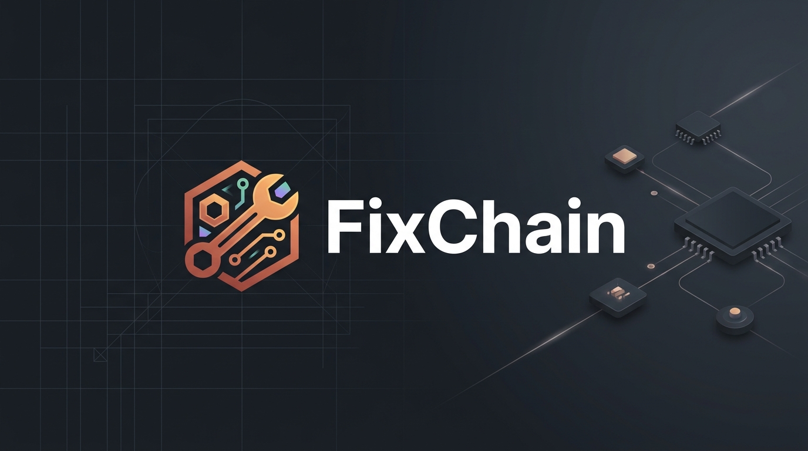

# FixChain — Taller de Servicio Técnico On-Chain



**Ruta elegida:** **Proyecto propio** (Solana Engineering Track: Advanced — WayLearn)

**FixChain** es una aplicación descentralizada (dApp) en **Solana Devnet** para administrar un taller de servicio técnico mediante cuentas PDA jerárquicas de tres niveles (`Taller` → `Equipo` → `Orden`). Permite crear talleres, registrar dispositivos con identificador automático, abrir órdenes de reparación, actualizar su costo y cerrar órdenes recuperando la renta en SOL.

---

## 1. Despliegue en Solana Devnet

- **Red:** Solana Devnet
- **Program ID:** `6uZx9cK4nttnnUZjzT5GpcjZ1zZsv7CtDjmYDSiCbnQ`
- **Solana Explorer (Devnet):** [Ver programa en Devnet](https://explorer.solana.com/address/6uZx9cK4nttnnUZjzT5GpcjZ1zZsv7CtDjmYDSiCbnQ?cluster=devnet)
- **Repositorio del programa Anchor (standalone):** [ema28pro/Taller-Servicio-Solana-PDA](https://github.com/ema28pro/Taller-Servicio-Solana-PDA)

---

## 2. Arquitectura y aporte propio

Partiendo de la arquitectura de referencia de WayLearn (`Registro-Ventas-Solana-PDA` y `Registro-Ventas-Solana-App`), se diseñó e implementó un caso de uso completo desde cero:

### Programa Anchor (`programa/src/lib.rs`)
- **Jerarquía de PDAs:**
  - `Taller`: `[b"taller", nombre_taller.as_bytes(), owner.key().as_ref()]` (`nombre_taller` máx. 30 bytes, hasta 10 equipos, `id_counter: u16`, `owner: Pubkey`).
  - `Equipo`: `[b"equipo", taller.key().as_ref(), id_equipo.to_le_bytes().as_ref()]` (ID automático incremental asignado por el programa, `modelo` máx. 30 bytes, hasta 10 órdenes).
  - `Orden`: `[b"orden", equipo.key().as_ref(), codigo.as_bytes()]` (`codigo` máx. 8 bytes, `diagnostico` máx. 50 bytes, `costo: u32` en unidades enteras/centavos).
- **Instrucciones:** `crear_taller`, `registrar_equipo`, `crear_orden`, `cambiar_costo` y `cerrar_orden` (`close = owner`).
- **Reglas de seguridad y validaciones:**
  - Autoridad validada desde la raíz con `has_one = owner @ Errores::NoOwner`.
  - Validación de capacidad máxima de 10 elementos por vector (`require!(..., Errores::LimiteAlcanzado)`).
  - Validación de existencia en el índice al cerrar órdenes (`require!(equipo.ordenes.contains(&orden_key), Errores::NoOrden)`).

### Frontend y Cliente Tipado (`src/` y `clients/js/`)
- **IDL y Cliente Codama:** `idl.json` exportado desde Solana Playground y cliente regenerado automáticamente en `clients/js/src/generated/`.
- **Capa Solana (`src/solana/`):** derivación exacta de PDAs en `pdas.ts` (incluyendo `u16` little-endian), lecturas encadenadas en `lecturas.ts`, validaciones de longitud/cupo en `validaciones.ts` y transacciones firmadas en `acciones.ts`.
- **Interfaz FixChain (`src/components/Taller.tsx`, `src/App.tsx`):** identidad visual propia (favicon, banner integrado y paleta carbón/ámbar) con flujo completo de creación, consulta, edición y cierre de órdenes.

---

## 3. Cómo configurar y ejecutar localmente

### Requisitos
- **Node.js** `>= 22.12.0`
- Una wallet compatible con Solana (**Phantom** o **Solflare**) configurada en **Devnet** con SOL de prueba ([faucet.solana.com](https://faucet.solana.com)).

### Pasos
```bash
# 1. Instalar dependencias
npm install

# 2. Verificar tipos y coherencia entre IDL, Program ID y cliente Codama
npm run typecheck
npm run comprobar:idl

# 3. Compilar versión de producción
npm run build

# 4. Iniciar la aplicación en modo desarrollo
npm run dev
```

Abre la URL local que muestre Vite (por defecto `http://localhost:5173`), conecta tu wallet en **Devnet** y prueba el flujo completo desde la pestaña **Taller de servicio**.

---

## 4. Pruebas y evidencias

### Prueba on-chain en Solana Devnet (`programa/tests/anchor.test.ts`)
Ejecutada en Solana Playground contra el programa desplegado `6uZx9cK4nttnnUZjzT5GpcjZ1zZsv7CtDjmYDSiCbnQ`:

```text
  Taller de Servicio (taller -> equipo -> orden)
    ✔  flujo completo: crear taller, registrar equipo, crear orden, cambiar costo y cerrar orden (5076ms)
  1 passing (5s)
```

### Verificaciones del frontend
- `node scripts/verificar-consistencia.mjs`: **46/46 `[PASS]`**, `0 [FAIL]` (alineación byte a byte de semillas, tipos, orden de argumentos y límites entre `programa/src/lib.rs` y `src/solana/*`).
- `npm run typecheck` (`tsc -b`): **0 errores**.
- `npm run comprobar:idl`: `Contrato coherente: IDL, Program ID y cliente generado.`
- `npm run build` (`vite build`): **326 módulos transformados**, build de producción exitoso.
- Pruebas funcionales en vivo desde la interfaz web conectada con wallet en **Solana Devnet** (creación de taller, registro de equipo, creación/actualización/cierre de orden).
